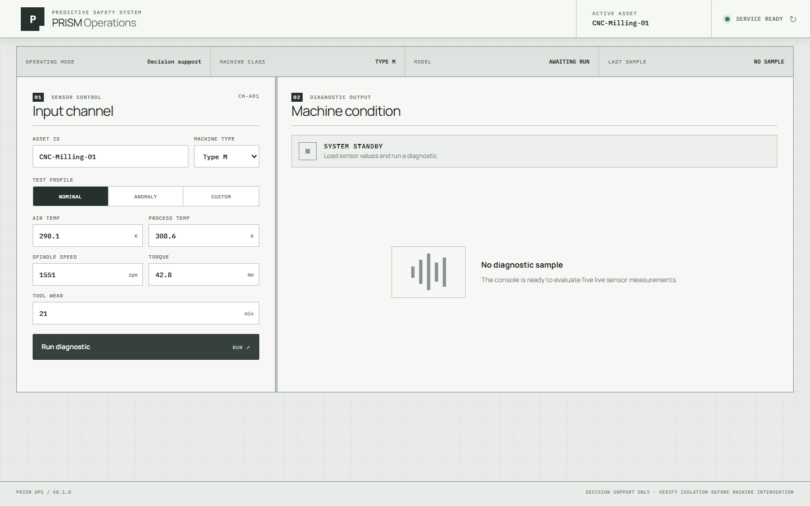
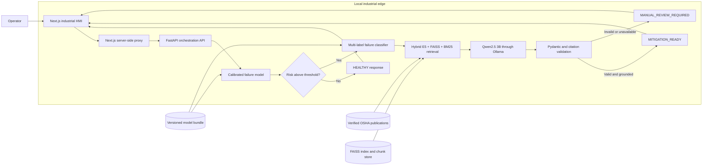
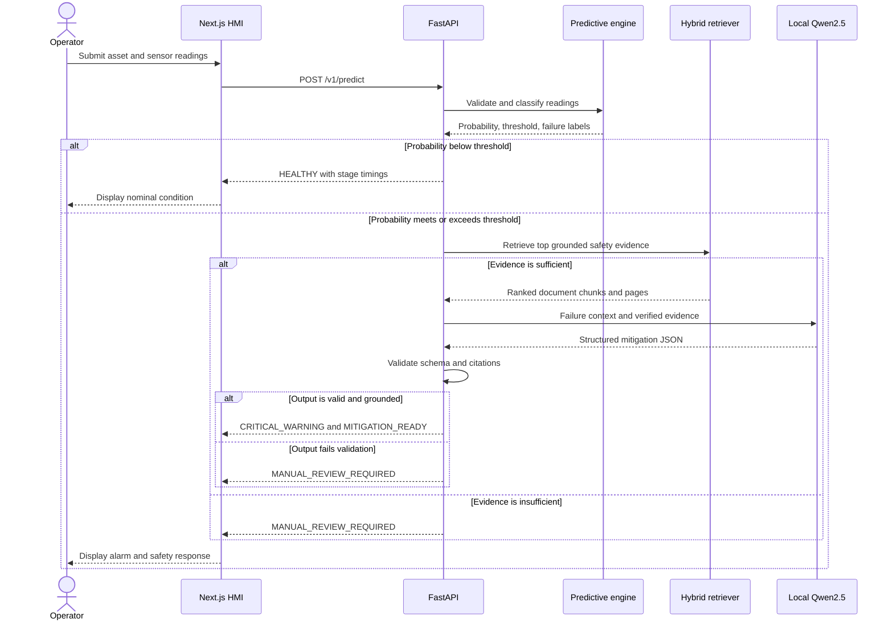
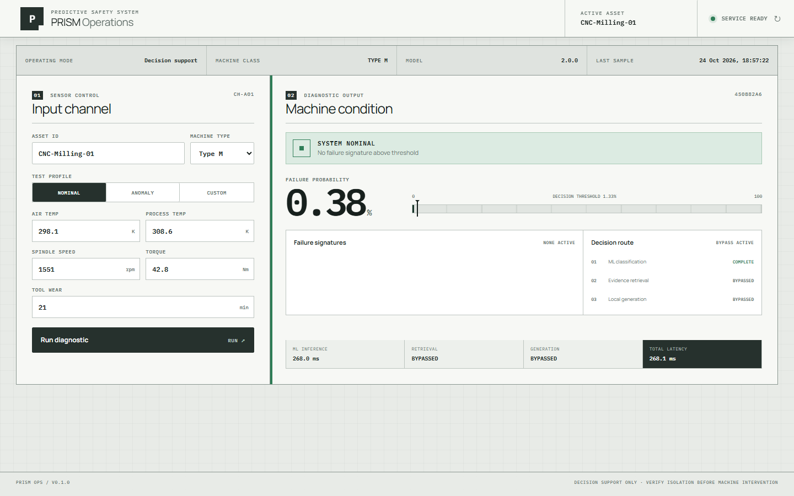

# P.R.I.S.M.

### Predictive Retrieval for Industrial Safety & Maintenance

An offline-first predictive maintenance and safety decision-support system. PRISM combines
calibrated machine-learning inference, hybrid knowledge retrieval, and a locally hosted LLM
to turn industrial sensor readings into traceable, schema-validated mitigation guidance.

[](https://github.com/mifthrizky/P.R.I.S.M./actions/workflows/quality.yml)
[](https://www.python.org/)
[](web/package.json)
[](LICENSE)



> [!WARNING]
> PRISM provides decision support only. It must not issue commands directly to machinery,
> PLCs, or safety systems. A qualified human must verify isolation and authorize every
> intervention.

## Contents

- [Overview](#overview)
- [Validated results](#validated-results)
- [System architecture](#system-architecture)
- [Request lifecycle](#request-lifecycle)
- [Technology stack](#technology-stack)
- [Operator experience](#operator-experience)
- [Quick start](#quick-start)
- [API usage](#api-usage)
- [Engineering workflows](#engineering-workflows)
- [Project structure](#project-structure)
- [Known limitations](#known-limitations)

## Overview

PRISM evaluates five machine measurements from the AI4I predictive-maintenance domain:
air temperature, process temperature, spindle speed, torque, and tool wear. A calibrated
binary classifier estimates failure risk, while a second multi-label model identifies
TWF, HDF, PWF, and OSF failure signatures.

The runtime is deliberately conditional:

- **Healthy readings** return immediately; document retrieval and generation are bypassed.
- **Critical readings** trigger hybrid FAISS/BM25 retrieval over verified safety documents.
- **Grounded evidence** is supplied to Qwen2.5 running locally through Ollama.
- **Every LLM response** must pass a strict Pydantic schema and citation-grounding checks.
- **Weak evidence, malformed output, or service failure** produces
  `MANUAL_REVIEW_REQUIRED` instead of unverified instructions.

The repository includes reproducible training, versioned artifacts, a FastAPI orchestration
service, an industrial Next.js HMI, Docker Compose packaging, acceptance benchmarks, and CI.

## Validated results

| Gate | Result | Requirement | Status |
|---|---:|---:|:---:|
| Binary holdout ROC-AUC | `0.9604` | `>= 0.88` | Pass |
| Holdout failure recall | `0.9118` | Safety-oriented threshold | Pass |
| RAG document Recall@5 | `1.0000` | `1.00` | Pass |
| Structured-output validation | `100%` | `100%` | Pass |
| Anomaly orchestration p95 | `715.238 ms` | `< 3 s` | Pass |

The binary model is a calibrated Random Forest selected against XGBoost using identical
five-fold splits. Its operational threshold is `0.01326`; the low value is intentional
because missed failures are treated as more costly than false alarms.

> [!NOTE]
> The recorded latency benchmark uses a deterministic, schema-valid generator to measure
> application orchestration. It does **not** claim live Qwen/Ollama latency. Hardware-specific
> LLM benchmarking remains a separate deployment check. TWF is also the weakest subtype due
> to limited positive examples in AI4I; its metrics remain visible in the model metadata.

Detailed evidence:

- [Acceptance report](artifacts/acceptance_report.json)
- [Model metadata and per-label metrics](artifacts/model_metadata.json)
- [RAG evaluation report](artifacts/knowledge/evaluation_report.json)
- [Knowledge-index metadata](artifacts/knowledge/index_metadata.json)

## System architecture



All inference components run locally after their model and document caches have been
populated. The browser talks only to Next.js proxy routes; the proxy communicates with the
FastAPI service inside the Compose network.

## Request lifecycle



## Technology stack

| Layer | Technologies | Responsibility |
|---|---|---|
| Data and features | Python, pandas, NumPy | Dataset validation, feature engineering, deterministic splits |
| Predictive ML | scikit-learn, XGBoost, joblib | Candidate comparison, calibration, threshold selection, artifact persistence |
| Failure classification | One-vs-Rest Random Forest | Multi-label TWF, HDF, PWF, and OSF probabilities |
| Dense retrieval | Multilingual E5, Sentence Transformers, FAISS `IndexFlatIP` | Semantic retrieval over page-preserving safety chunks |
| Sparse retrieval | BM25, Reciprocal Rank Fusion | Keyword retrieval and dense/sparse result fusion |
| Document ingestion | PyMuPDF | PDF extraction, normalization, chunking, and page metadata |
| Local generation | Qwen2.5 3B, Ollama | Offline mitigation generation from retrieved evidence |
| Validation | Pydantic | Strict response schema and citation grounding |
| API | FastAPI, Uvicorn, httpx | Request validation, orchestration, health, readiness, and LLM transport |
| Web HMI | Next.js 16, React 19, TypeScript 5, Tailwind CSS 4, custom CSS | Operator input, alarms, telemetry, mitigation, and server-side API proxy |
| Infrastructure | Docker Compose, NVIDIA GPU profile, named volumes | Reproducible local deployment and persistent model caches |
| Quality | pytest, Ruff, ESLint, GitHub Actions | Unit, integration, acceptance, lint, and production-build gates |

## Operator experience

The light industrial HMI keeps sensor control and diagnostic output in one desktop viewport.
It exposes API readiness, asset identity, validated sensor bounds, failure probability,
decision threshold, ranked failure signatures, decision routing, and per-stage latency.



Critical results reveal grounded mitigation in this order: immediate action, required PPE,
safety sequence, and page-level citations. A validation or retrieval failure becomes a
prominent safety lockout rather than a partial recommendation.

## Quick start

### Prerequisites

- Docker Desktop with Docker Compose.
- NVIDIA GPU and container GPU support for the supplied Ollama profile.
- Internet access on first boot to pull images, Qwen weights, and the E5 embedding model.
- Sufficient disk space for container images and persistent model caches.

### Start the complete stack

```powershell
git clone https://github.com/mifthrizky/P.R.I.S.M..git prism
cd prism

docker compose config --quiet
docker compose up --build -d
docker compose ps

Invoke-RestMethod http://127.0.0.1:8000/ready
```

Open the operator dashboard at [http://127.0.0.1:3000](http://127.0.0.1:3000).
FastAPI documentation is available at
[http://127.0.0.1:8000/docs](http://127.0.0.1:8000/docs).

Follow first-start progress or stop the stack with:

```powershell
docker compose logs -f
docker compose down
```

Named volumes retain the Ollama and Hugging Face caches, allowing later restarts to operate
without an external inference service. See the [operations runbook](docs/operations.md) for
configuration, verification, safety, and rollback procedures.

<details>
<summary><strong>Manual development setup</strong></summary>

Python 3.12 or newer and Node.js 22 are recommended.

```powershell
python -m venv .venv
.\.venv\Scripts\python.exe -m pip install -e . -r requirements-dev.txt
```

Start Ollama in a separate terminal:

```powershell
ollama serve
```

Pull the local model and start the API in another terminal:

```powershell
ollama pull qwen2.5:3b
$env:HF_HOME = "$PWD\.cache\huggingface"
$env:PRISM_OLLAMA_URL = "http://127.0.0.1:11434"
.\.venv\Scripts\python.exe -m uvicorn prism.api.app:app --host 127.0.0.1 --port 8000
```

Start the HMI in a third terminal:

```powershell
cd web
npm ci
$env:PRISM_API_URL = "http://127.0.0.1:8000"
npm run dev
```

</details>

## API usage

| Method | Endpoint | Purpose |
|---|---|---|
| `GET` | `/health` | Process liveness; does not guarantee artifacts are loaded |
| `GET` | `/ready` | Model and knowledge-index readiness |
| `POST` | `/v1/predict` | Validate sensor data and run the conditional inference pipeline |

### Nominal request

```json
{
  "sensor_id": "CNC-Milling-01",
  "timestamp": "2026-08-31T08:00:00Z",
  "machine_type": "M",
  "metrics": {
    "air_temperature_k": 298.1,
    "process_temperature_k": 308.6,
    "rotational_speed_rpm": 1551,
    "torque_nm": 42.8,
    "tool_wear_min": 21
  }
}
```

A representative nominal response follows the public `PredictionResponse` contract:

```json
{
  "request_id": "<correlation-id>",
  "sensor_id": "CNC-Milling-01",
  "timestamp": "2026-08-31T08:00:00Z",
  "status": "HEALTHY",
  "failure_probability": 0.00379,
  "threshold": 0.01326,
  "primary_failure": null,
  "failure_predictions": [],
  "machine_type": "M",
  "machine_type_assumed": false,
  "model_version": "2.0.0",
  "mitigation": null,
  "timings": {
    "ml_ms": 0.0,
    "retrieval_ms": null,
    "generation_ms": null,
    "total_ms": 0.0
  }
}
```

Latency values vary by host. The important behavior is that a healthy request bypasses RAG
and generation, represented by `null` downstream timings.

### Anomaly request

```json
{
  "sensor_id": "CNC-Milling-01",
  "timestamp": "2026-08-31T08:15:00Z",
  "machine_type": "M",
  "metrics": {
    "air_temperature_k": 304.5,
    "process_temperature_k": 313.2,
    "rotational_speed_rpm": 1201,
    "torque_nm": 71.2,
    "tool_wear_min": 215
  }
}
```

This payload crosses the learned threshold, identifies OSF as the primary signature, and
activates retrieval and generation. The final mitigation is returned only if its JSON schema
and every cited document/page match the supplied evidence.

## Engineering workflows

### Reproducible training

```powershell
.\.venv\Scripts\python.exe -m prism.ml.train --config configs/training.json
.\.venv\Scripts\python.exe -m prism.ml.evaluate --config configs/training.json
.\.venv\Scripts\python.exe -m prism.ml.inference --demo
```

Training compares Random Forest and XGBoost with identical five-fold splits, calibrates the
selected binary classifier, learns validation-set thresholds, and writes a versioned bundle
plus readable metadata into `artifacts/`.

> [!CAUTION]
> `joblib` artifacts use Python pickle semantics and may execute code when loaded. Load only
> the artifact committed to this trusted repository or artifacts produced by a trusted build.

### Knowledge-index build and evaluation

```powershell
$env:HF_HOME = "$PWD\.cache\huggingface"
.\.venv\Scripts\python.exe -m prism.rag.index
.\.venv\Scripts\python.exe -m prism.rag.evaluate
.\.venv\Scripts\python.exe -m prism.rag.retriever "lockout procedure before maintenance"
```

The current knowledge base contains four checksum-verified public OSHA publications,
334 page-preserving chunks, and 384-dimensional Multilingual E5 embeddings.

### Quality and acceptance

```powershell
.\.venv\Scripts\python.exe -m ruff check src tests
.\.venv\Scripts\python.exe -m pytest
.\.venv\Scripts\python.exe -m prism.benchmark --runs 100
.\scripts\validate_phase8.ps1
```

GitHub Actions repeats Python lint/tests/acceptance and the frontend lint/production build on
every push to `main` and on pull requests.

<details>
<summary><strong>Development history</strong></summary>

1. **Reproducible ML foundation** — deterministic configuration, reusable training modules,
   versioned artifacts, and metadata.
2. **Calibrated predictive engine** — model comparison, probability calibration,
   safety-oriented thresholding, and multi-label failure classification.
3. **Offline hybrid retrieval** — verified PDF ingestion, E5 embeddings, FAISS, BM25, and RRF.
4. **Validated local generation** — Ollama/Qwen client, strict schemas, citation checks, and
   safe manual-review fallback.
5. **Backend orchestration** — FastAPI contracts, health/readiness, conditional pipeline, and
   stage timings.
6. **Acceptance and benchmarking** — ML, retrieval, schema, fault-injection, and latency gates.
7. **Operational packaging** — non-root containers, persistent caches, runbook, and CI.
8. **Industrial operator HMI** — responsive sensor controls, alarms, diagnostics, telemetry,
   and grounded mitigation display.

</details>

## Project structure

```text
PRISM/
├── artifacts/              Versioned model, reports, FAISS index, and chunk store
├── configs/                Reproducible training configuration
├── docs/                   Operations runbook and README assets
├── documents/              Verified source PDFs, manifest, and retrieval evaluation queries
├── scripts/                Setup and phase-validation commands
├── src/prism/
│   ├── api/                FastAPI contracts and orchestration runtime
│   ├── llm/                Ollama client and strict mitigation schemas
│   ├── ml/                 Features, training, evaluation, inference, and persistence
│   └── rag/                PDF ingestion, index build, hybrid retrieval, and evaluation
├── tests/                  Unit, integration, and acceptance tests
├── web/                    Next.js industrial HMI and server-side API proxy
├── compose.yaml            Complete local deployment
└── pyproject.toml          Python package, tools, and command entry points
```

## Known limitations

- Live Qwen/Ollama latency depends on deployment hardware and is not represented by the
  deterministic acceptance benchmark.
- TWF has substantially fewer positive examples than other failure types and remains the
  weakest subtype classifier.
- The low binary threshold prioritizes recall and therefore produces more false positives;
  operators must treat alerts as requests for inspection, not confirmed failures.
- The supplied Compose profile expects NVIDIA GPU support for Ollama.
- Initial installation requires network access; offline operation begins after image and model
  caches have been populated.
- PRISM does not provide PLC actuation, authentication, TLS termination, long-term telemetry,
  or a replacement for site-specific safety procedures.

## License

Released under the [MIT License](LICENSE).
